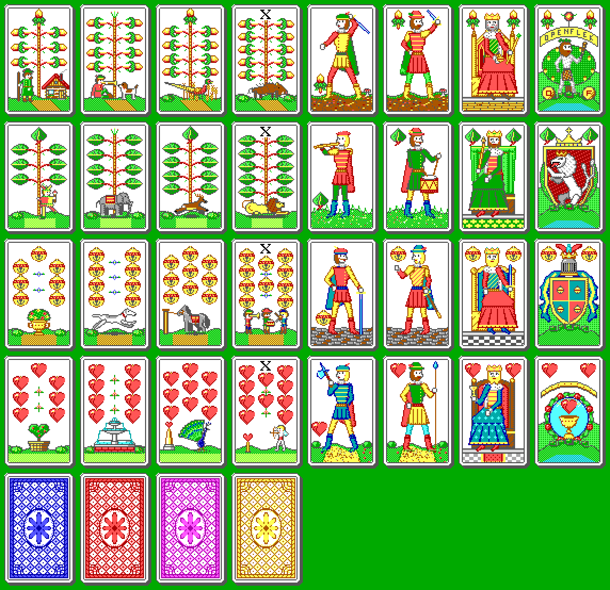

# OpenFlek

An open-source remake of **FLEK!**, the 1991–1992 Czech DOS card game by
J. Pivoňka: *volený mariáš* for one human and two computer players, with
flek/re/tutti doubling and settlement in Kč.

The remake follows the original program closely: its rules, scoring,
computer-player logic, screen layout, dialogs and PC-speaker sounds were
reconstructed by studying the 1992 executable. The 16-colour EGA card art
is new, drawn by a generator in `scripts/deck_gen` in the spirit of the
original Czech mariáš deck.



## Building and running

Requires Rust 1.85+ (edition 2024).

```bash
cargo run --release
```

Works on Linux, Windows and macOS (macroquad). On Linux the window needs
X11 or Wayland with OpenGL, and building with sound needs the ALSA development
package:

```bash
sudo apt install libasound2-dev
```

(Fedora: `alsa-lib-devel`, Arch: `alsa-lib`.) Without it, build the silent
variant:

```bash
cargo run --release --no-default-features
```

Command-line switches belong to the `openflek` binary. `cargo run` forwards
only the arguments that follow `--`:

```bash
cargo run --release -- --quick
```

| switch | meaning |
|---|---|
| `-q`, `--quick` | no pauses after tricks; forced cards are played automatically |
| `-s`, `--silent` | no sound; on a windowed run this is saved, so later runs stay silent until sound is turned back on |
| `--skip-intro` | skip the title screen and the credits |
| `--iq N` | strength of the computer players, 1..255 (0 = ask); on a windowed run this is saved |
| `--seed N` | fixed random seed (reproducible deals) |
| `--deals N` | stop after N deals, in a window or headless |
| `--headless` | no window; the computer plays your seat (testing). Uses IQ 100 unless `--iq` is set |
| `--autoplay`, `--shots DIR` | testing aids: computer plays your seat; save a screenshot every second |

Without `--deals`, a headless run continues until the balance reaches zero.
The balance starts at 100.00 Kč. A headless run leaves `openflek.cfg` unread
and unwritten.

Settings (sound, table colour, table pattern, menu colour, IQ) are saved to
`openflek.cfg` in the platform config directory (`~/.config/openflek` on Linux).
A windowed run writes that file at start-up.

## Controls

Keyboard, as in the original; the mouse works too.

* **← →** move the arrow over your cards, **Enter** plays the card (or click it).
* In menus: arrows to move, **Enter** to choose, or press a button's first letter.
* **F10** opens the options (sound, table colour, pattern, menu colour, IQ, save).
* **Esc** asks whether to quit.

## Rules as implemented

* 32 German-suited cards. Rank order 7 8 9 spodek svršek král 10 eso; in betl and
  durch 7 8 9 10 spodek svršek král eso.
* Between hands the cards are gathered and cut twice. A deal that ended early is
  replaced by a fresh deck, cut 32 times. Cards are dealt in packets of 7 + 5×5.
  The forehand gets 12 cards, chooses trumps from his first seven (or blind from
  the rest), discards two (no tens or aces in a trump game) and says *Barva?*.
  A defender who answers *Špatná* takes over with betl or durch; a betl can only
  be overtaken by a durch.
* Contracts: hra, sedma, stovka, 107, betl, durch. Defenders may *flek* the game
  and/or the seven, or announce *sedma proti*. The declarer answers with *re*,
  and the raise can continue through *tutti*, *boty*, *kalhoty*, *kabát*,
  *klobouk* and *kaput*; each level doubles the stake.
* Must follow suit, must beat, must trump, the third player must over-trump.
  A held marriage must be shown with the svršek first; an announced trump
  seven is kept for the last trick.
* An unflekked plain game is settled without being played, as is a seven whose
  game was doubled once and whose seven was not.
* Prices in units of 0.10 Kč: hra 1, sedma 2, stovka 4 (doubling per 10 points over
  100), betl 5, durch 10; hearts double everything; silent hundred and silent
  seven are scored. Each defender pays the declarer or is paid by him.
* The computer players evaluate hands, decide doubles by simulating the deal,
  and choose cards with heuristics plus a Monte-Carlo search whose depth and
  budget grow with IQ. Like in the 1992 original, they play double-dummy (they
  see everybody's cards).

## Code layout

| path | contents |
|---|---|
| `src/game/` | rules engine: cards, deal and trick rules (`round`), hand evaluation (`analysis`), scoring (`settle`), computer players (`ai`) |
| `src/gfx/` | indexed-colour framebuffer with BGI-style primitives; 8×8 font with Czech letters |
| `src/art/` | card faces from a bundled bitmap (`deck_data.bin`); backs and the card frame drawn at runtime |
| `scripts/deck_gen/` | Python generator for the card faces: `python3 scripts/deck_gen/build_sheet.py` rewrites `deck_data.bin` |
| `src/app/` | screens and dialogs, the game flow, options, title screen |
| `src/config.rs`, `src/sound.rs` | settings file; square-wave "PC speaker" sounds |
| `examples/card_sheet.rs` | renders the deck to a PNG: `cargo run --example card_sheet -- out.png 2` |

## Testing

```bash
cargo test
```

Unit tests cover the rules, scoring, AI legality and the drawing code. An
integration test plays complete deals headless through the real game flow.

## Credits and license

Original game FLEK! © 1991–1992 Jaroslav Pivoňka. OpenFlek is an independent
re-implementation and is not affiliated with the original author.

The 8×8 base font comes from the [`font8x8`](https://crates.io/crates/font8x8)
crate (MIT, derived from public-domain glyphs); the Czech letters are composed
by this project.

OpenFlek is released under the MIT license, see [LICENSE](LICENSE).
